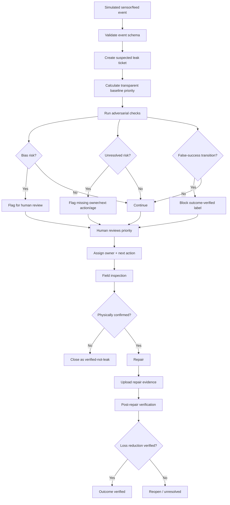

# WEEK 11 BUSINESS BENDING — PACKET

**Student:** Diego Gil  
**Role:** ADVERSARY  
**Team:** Team 3  
**Chapter:** Dreaming of Plenitude  
**Primary vacuum:** LOSS VISIBILITY  
**Product:** AquaRail Red Team  
**Working slice:** adversarial test harness for leak prioritization, unresolved tickets, and false-success labels  
**Product language:** Spanish (Mexico)  
**Documentation language:** English

## 1. Problem in my own words

Mexico does not need another leak dashboard that stops at detection. The Week 11 Blueprint defines the real operational gap as the path from a suspected municipal water-network leak to inspection, assignment, physical repair, and verified outcome.

The adversarial problem is that a workflow can look successful while still failing in three ways:

1. **Biased prioritization** — a model or rule sends crews first to high-value / easy-to-serve areas while vulnerable communities wait.
2. **Unresolved tickets** — leaks are detected and assigned but sit indefinitely without an owner, next action, or escalation.
3. **False success labels** — a ticket is marked “closed” or “repaired” without evidence that the physical leak was confirmed or that post-repair loss actually fell.

AquaRail Red Team is not primarily a new sensor product. It is a working adversarial QA layer that feeds labeled simulated leak events into a human-reviewed prioritization workflow and tries to break the system before real communities pay for the failure.

> **A closed ticket is not the same thing as a verified reduction in water loss.**

## 2. Exact user

**Primary user:** municipal water-utility operations lead / supervisor responsible for leak-response quality, auditability, and dispatch fairness.

**Synthetic build persona: Laura Mendoza, 41 — fictional / synthetic**
- Operations supervisor at a medium-sized municipal water utility.
- Manages a small repair-dispatch team.
- Receives suspected leak events from mixed sources: sensor alerts, field reports, citizen calls, spreadsheets.
- Has incomplete data, limited crews, political pressure, and pressure to show closed tickets.
- Needs to know whether a prioritization rule is systematically disadvantaging vulnerable zones.
- Needs unresolved events to surface automatically.
- Distrusts “AI found the answer” claims that cannot be physically verified.
- Must explain why one event was prioritized over another.

**Secondary actor:** field crew member who confirms whether a suspected event is physically real and records repair evidence.

No real names, addresses, utility data, or production leak records are used in the demo.

## 3. Success definition

**Before the module closes, a live web app works where an operator can:**

1. Load a labeled simulated IoT feed of suspected leak events.
2. See each event on a simple geodata map and in a table.
3. Each event includes event ID, synthetic location, estimated loss, service interruption, repair feasibility, community vulnerability, confidence, age/time unresolved, and current status.
4. Run a transparent rule-based / lightweight ML-style priority score.
5. Compare a naive “maximize water recovered” ranking against a human-reviewed equity-aware ranking.
6. Flag potential bias when a high-vulnerability event is systematically pushed behind lower-vulnerability events for weak reasons.
7. Flag unresolved tickets when an event has no owner, no next action, or exceeds an age threshold.
8. Prevent a ticket from being called outcome verified unless physical confirmation, repair evidence, and post-repair outcome evidence exist.
9. Show the difference between suspected, physically confirmed, repaired, and outcome verified.
10. Allow a human reviewer to override a machine/rule recommendation with a written reason.
11. Keep all simulated sensor / ML outputs visibly labeled.
12. Produce an adversarial test summary: biased-priority flags, unresolved-ticket flags, false-success attempts blocked, and human overrides.
13. `npm test` passes.
14. `npm run build` passes.
15. At least two production deploys occur, including one after a documented bug fix.

## 4. IMAGE-GENERATED mockup

**Target file:** `assets/mockup-aquarail-redteam.png`

The mockup should show:
- Header: **AquaRail Red Team**
- Subtitle: **“Detectar no es reparar. Cerrar no es verificar.”**
- Event list + synthetic geodata map
- Priority comparison: “Ranking por pérdida” vs “Ranking con vulnerabilidad”
- Red-team flags:
  - **Posible sesgo**
  - **Ticket sin siguiente acción**
  - **Cierre no verificado**
- Status ladder:
  - Sospechoso
  - Confirmado físicamente
  - Reparado
  - Resultado verificado
- Human review:
  - Aprobar prioridad
  - Cambiar prioridad
  - Motivo del cambio
- Audit card: owner, next action, status, evidence, last update
- Disclosure: **“Datos y sensores simulados para esta demostración.”**
- Shadow rule: **“La prioridad final requiere revisión humana. No se permite priorizar por capacidad de pago.”**

## 5. Main flow — Mermaid

## 6. Swimlane — Mermaid

```mermaid
flowchart LR
    subgraph FEED[SIMULATED IoT / DATA FEED]
        F1[Emit suspected event]
        F2[Estimated loss + confidence + location]
    end

    subgraph SYSTEM[AQUARAIL RED TEAM]
        S1[Validate event]
        S2[Calculate baseline priority]
        S3[Run bias test]
        S4[Run unresolved-ticket test]
        S5[Validate state transition]
        S6[Generate audit flags]
    end

    subgraph HUMAN[HUMAN OPERATOR]
        H1[Review priority]
        H2[Override with reason if needed]
        H3[Assign owner and next action]
        H4[Confirm closure status]
    end

    subgraph CREW[FIELD CREW]
        C1[Inspect physically]
        C2[Repair]
        C3[Upload evidence]
        C4[Record post-repair observation]
    end

    F1 --> F2 --> S1 --> S2 --> S3 --> S4 --> S5 --> S6
    S6 --> H1 --> H2 --> H3 --> C1
    C1 --> C2 --> C3 --> C4 --> H4
    H4 --> S5
```

**Boundary:** the system can flag and recommend. It cannot excavate, diagnose structural failure, dispatch major work, or declare final success without qualified human verification.

## 7. Benchmark line

**Best existing solution on Earth:** TaKaDu-style water-network event management combines utility telemetry, anomaly detection, and event workflows; ASTERRA and FIDO show that satellite/acoustic sensing can help locate probable leaks and guide field investigation.

**Mine differs/localizes by:** AquaRail Red Team does not compete on better sensing. It focuses on the downstream Mexican operational gap: testing whether prioritization is biased, whether tickets remain unresolved, and whether a workflow is falsely labeling “repair” as “verified outcome.”

Supporting reference from the Team Blueprint:
- adapt proven approaches from TaKaDu, ASTERRA, FIDO, Singapore PUB, and Manila Water;
- claim no proven Mexican pilot results.

## 8. Three-year long view

In three years, AquaRail Red Team becomes an independent quality and fairness layer sitting across municipal leak-detection and repair systems. It ingests events from sensors, satellite tools, utility SCADA, citizen reports, and spreadsheets, then continuously tests whether operations are biased, stalled, or claiming success without evidence. The product’s load-bearing walls remain human authority, auditable uncertainty, explicit service-vulnerability review, and a strict separation between detected, repaired, and outcome verified.

## 9. Scope cut

Not building:
- new physical leak sensors,
- real municipal SCADA integration,
- autonomous excavation,
- autonomous structural diagnosis,
- automatic major dispatch,
- national water map,
- citizen awareness campaigns,
- water-saving tips app,
- punitive household scoring,
- pay-to-prioritize service,
- automatic rationing,
- real household profiles,
- predictive billing,
- claims that simulated ML proves real water savings,
- claims that closing a ticket proves loss reduction.

Working slice:

> **simulated leak events → transparent priority logic → adversarial checks → human review → auditable state transitions → verified-outcome gate**

## 10. Blueprint conditions translated into product rules

### Condition 1 — Actionable closure
Every event must have owner, next action, current status, last update, and resolution record. If any are missing beyond a threshold, flag unresolved.

### Condition 2 — Human authority
The system may recommend and flag. It may not order excavation, perform structural diagnosis, dispatch major work automatically, or declare final outcome without human verification.

### Condition 3 — Incremental evidence
Compare baseline simple ranking with vulnerability-aware ranking. Track unresolved time, number of verified repairs, false-success attempts, bias flags, and human overrides. Do not claim real water-loss reduction from simulated data.

### Condition 4 — Shadow clause
Include community/service vulnerability in human-reviewed prioritization. Never prioritize by ability to pay, profile households punitively, or automate discriminatory rationing.

### Condition 5 — Local feasibility
Use simulated feeds, low-cost browser app, familiar ticket workflow, simple geodata, and transparent scoring. Every added ML or sensing component must have a reason.

### Condition 6 — Truth and auditability
Statuses remain distinct:
1. suspected
2. physically confirmed
3. repaired
4. outcome verified

Uncertainty remains visible. Human corrections remain in the audit trail.

## 11. Architecture + Dragon Stack

| Layer | Tool / approach | Purpose |
|---|---|---|
| Frontend | Next.js + React + TypeScript | Operator dashboard, event details, test summary |
| Styling | Tailwind CSS | Responsive interface |
| IoT / sensing | Simulated labeled JSON/CSV feed | Week 11 sensing layer without fake hardware claims |
| ML / scoring | Transparent lightweight scoring model / deterministic classifier | Priority estimate and adversarial comparison |
| Geodata | Leaflet + OpenStreetMap or simple static coordinate map | Spatial context for synthetic events |
| Adversarial rules | TypeScript pure functions | Bias, unresolved, false-success checks |
| Validation | Zod | Event schema, transitions, override reasons |
| Tests | Vitest + Testing Library | Logic, state transitions, shadow clause |
| Persistence | Browser-local synthetic state only | Avoid personal-data auth requirements |
| Deployment | Vercel | Live URL |
| Version control | Git + GitHub | Packet-before-code evidence |

### Dragon Stack

**IoT/sensing + ML + geodata**

- IoT/sensing: simulated and visibly labeled feed.
- ML: lightweight transparent priority model; no opaque “AI says so.”
- Geodata: synthetic event locations.
- Adversarial logic: tests whether the operational workflow can be trusted.

## 12. Data model

### LeakEvent
- `id`
- `syntheticLocation`
- `lat`
- `lng`
- `estimatedLossLps`
- `serviceInterruptionScore`
- `repairFeasibilityScore`
- `communityVulnerabilityScore`
- `sensorConfidence`
- `createdAt`
- `owner | null`
- `nextAction | null`
- `status`

### LeakStatus
- `suspected`
- `physically_confirmed`
- `repaired`
- `outcome_verified`
- `verified_not_leak`
- `reopened`

### Evidence
- `inspectionConfirmed`
- `repairEvidencePresent`
- `postRepairVerificationPresent`
- `postRepairLossReduced`

### PriorityResult
- `baselineScore`
- `equityAwareScore`
- `rankDifference`
- `biasFlag`
- `reasonCodes[]`

### AdversarialFlags
- `unresolvedFlag`
- `missingOwner`
- `missingNextAction`
- `staleTicket`
- `falseSuccessAttempt`
- `biasRisk`

### HumanOverride
- `previousPriority`
- `newPriority`
- `reason`
- `timestamp`

No real household names, exact addresses, utility credentials, or real operational records are required.

## 13. Security floor

1. No secrets in repo; `.env*` ignored.
2. No real household or worker data; browser-local synthetic state only.
3. RLS not applicable because no remote user-data database exists.
4. Validate all editable fields with Zod: bounded scores, valid coordinates, valid state transitions, override-reason length limits.
5. Demo data synthetic and clearly labeled; no real addresses, telemetry, reports, or household data.

## 14. Test plan

### Mechanical pass

Test:
1. malformed simulated event rejected;
2. invalid coordinates rejected;
3. impossible vulnerability / feasibility scores rejected;
4. priority calculation deterministic;
5. baseline ranking favors loss-only case as expected;
6. vulnerability-aware ranking can change order transparently;
7. changing vulnerability changes priority in documented direction;
8. no ability-to-pay field exists;
9. bias test flags a designed unfair case;
10. low-vulnerability event is not automatically invalid;
11. unresolved flag appears when owner missing;
12. unresolved flag appears when next action missing;
13. stale-ticket threshold works;
14. cannot transition directly from `suspected` to `outcome_verified`;
15. cannot outcome-verify without physical confirmation;
16. cannot outcome-verify without repair evidence;
17. cannot outcome-verify without post-repair verification;
18. `repaired` remains distinct from `outcome_verified`;
19. human override requires reason;
20. simulated sensor/ML labels visible;
21. views never claim verified loss reduction from merely closed ticket;
22. shadow rule visible;
23. no ability-to-pay prioritization;
24. no automatic major dispatch;
25. `npm test` passes;
26. `npm run build` passes.

Required cycle: find one real bug, document it, fix it, add regression coverage, redeploy.

## 15. Persona test plan

**Laura Mendoza, 41 — fictional municipal operations supervisor**
- limited crews;
- pressure to close tickets;
- skeptical of model recommendations;
- familiar with spreadsheets and dispatch tools;
- needs fast explanations;
- worries equity weighting becomes political or opaque;
- worries “verified” overstates what crews actually proved.

For each screen ask:
- Does Laura know why this event was prioritized?
- Can she see uncertainty?
- Can she distinguish suspected, confirmed, repaired, verified?
- Does the bias flag explain itself?
- Would she trust the ranking?
- Does the tool create more work than a spreadsheet?
- Can she find unresolved tickets quickly?
- Is human override clear?
- Does “outcome verified” require understandable evidence?
- Does the system feel like it replaces her judgment?

Log every confusion. Fix the worst one. Re-run. Document remaining risks.

## 16. Acceptance criteria

The slice passes only if:
- simulated sensing clearly labeled;
- ML/scoring transparent;
- geodata synthetic;
- prioritization includes vulnerability but never ability to pay;
- final priority human-reviewed;
- every ticket has owner / next action / status / resolution;
- unresolved tickets flagged;
- false-success transitions blocked;
- repaired != outcome_verified;
- uncertainty visible;
- human overrides recorded with reason;
- no autonomous excavation or major dispatch;
- no real PII or utility operational data;
- tests/build pass;
- live URL works.

## 17. Commit plan

1. `docs: establish week 11 packet before code`
2. `feat: establish AquaRail Red Team shell`
3. `feat: add simulated leak feed and geodata view`
4. `feat: add transparent priority scoring and comparison`
5. `feat: add adversarial bias and unresolved-ticket checks`
6. `feat: enforce verified-outcome state machine`
7. `test: cover blueprint constraints and adversarial failures`
8. mechanical fix commit
9. persona fix commit

At least two production deploys.

## 18. Session Close rule

Every coding session ends with:
1. update `docs/DECISIONS.md`;
2. record key decision;
3. record what changed;
4. record unresolved risk;
5. record security status;
6. write **Tomorrow’s first move**;
7. run tests/build;
8. commit;
9. push.

## 19. First implementation principle

**Do not reward the workflow for looking closed. Reward it for being auditable and true.**

If the system can call a leak “solved” without physical confirmation and post-repair evidence, the adversarial test should fail it.
